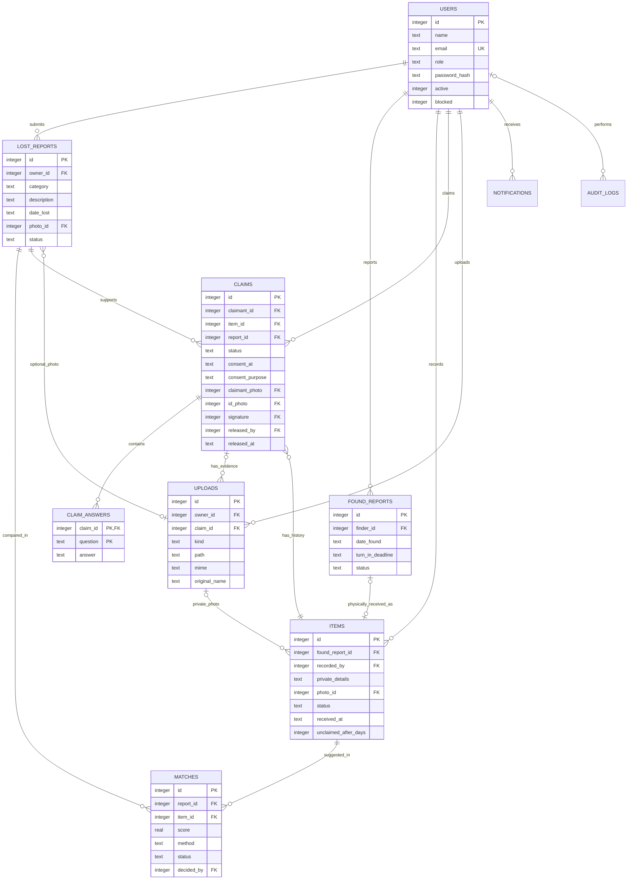

# Database guide

SQLite stores application records in the configured database file. By default, local demonstrations use `data/demo.sqlite3` and live mode uses `data/csa.sqlite3`; the start command can select a different path. `lyfind/schema.sql` is the authoritative business schema and `Database.initialize()` creates missing tables without clearing existing data. Every application connection enables foreign key checks and waits briefly for another write transaction to finish.

## Relationships

The diagram shows the central records; see the SQL for all fields, including color, brand, place, verification administrators, approval details, and timestamps. The authentication component additionally initializes `sessions`, `email_codes`, and `login_limits` for browser sessions, guest code verification, and sign in throttling.

## Data dictionary

| Table | Purpose and important checks |
|---|---|
| `users` | Unique email, one role, name parts, computed display name, account flags, optional password hash |
| `uploads` | Private file metadata, uploader, evidence claim association, file type, storage path, and creation time |
| `lost_reports` | Owner description and optional photo; status is open or closed |
| `found_reports` | LPU finder handoff queue; awaiting turn in or received |
| `items` | Physically received inventory with hidden identifying details and a configurable unclaimed period |
| `matches` | One record per report and item pair, score between 0 and 100, algorithm, and CSA decision |
| `claims` | All attempts, verification progress, consent purpose and time, evidence references, approval, and release record |
| `claim_answers` | One answer per `(claim_id, question)`; composite primary key and claim foreign key |
| `notifications` | Messages addressed to one user and optionally linked to their report or claim |
| `audit_logs` | Timestamped actor, action, and detail; update and delete operations are rejected by database triggers |

## Integrity rules

- Foreign keys reject references to missing users, items, reports, and uploaded files.
- A partial unique index permits only one active claim per item, including the initial online pending stage.
- A second partial unique index permits only one released claim per item.
- A found report can create at most one inventory item.
- Status triggers reject invalid item and claim transitions even if a caller tries to update status directly in SQL.
- Approval checks require recorded consent, verification administrators, and all required evidence references.
- Services wrap related record, notification, and audit writes in a transaction. A failed operation rolls back its partial changes.

Database constraints complement the service rules. Role permissions, ownership checks, confirmation before invitation, rejected attempt limits, file ownership and kind checks, and consent before evidence capture are enforced by services and the HTTP layer.

## Backup and restore

Stop the application before making a simple classroom backup. Copy the configured SQLite database file and its corresponding upload directory together to a safe location. Keep external identity and email credentials separately; do not include credentials in a shared submission archive.

To restore, stop the application, put the database and uploads back in their configured locations, and start the application again. Test a known report and an authorized private photo after restoration. A database only backup cannot recover uploaded photos and signatures.

The SQLite `Connection.backup()` API is suitable when a live consistent database snapshot is needed. A production backup process must coordinate that snapshot with the upload store and follow the institution's approved retention policy.

## Reliability (current)

- WAL journal, `synchronous=NORMAL`, `busy_timeout=15000`, foreign keys on, `PRAGMA user_version` for the schema version.
- Schema version 10: `lyfind/migrations.py` upgrades tables within a transaction. Before replacing legacy name or answer columns, it makes a database snapshot in `data/backups/schema_migrations/`. Invalid legacy answers stop and roll back the upgrade. Reopening a migrated database does not duplicate answers. SQLite 3.35+ is required.
- Write paths use `BEGIN IMMEDIATE`. A threaded stress test runs reports, claims and sign-ins at once and expects no "database is locked".
- Sessions, sign-ups, reports, uploads, matches, claims, transitions, notifications and audit logs survive a restart (tested).
- New tables: `sessions`, `email_codes` (hashed codes), `rate_events`, `roster`. New flags: `users.email_verified`, `lost_reports.flagged/hidden`, `found_reports.hidden`, `claims.flagged`.
- `python3 main.py --check-db`, `--backup` (online backup into `data/backups/<timestamp>`, with uploads) and `--reset-demo` (demo database only, backs up first).

## Portable image references

New uploads store relative filenames. `lyfind/storage.py` resolves them only inside the current upload store and also supports earlier absolute references by their local filename. Copying the database together with uploads therefore preserves the records after moving the project. Missing required images prevent approval or release without changing claim state.

## Normalization applied to LyFind

Normalization is based on functional dependencies and what each record means.
Splitting a name into parts by itself does not prove that a table is in 3NF.
Likewise, repeated category values in different reports do not automatically
require a category table: no category description or other category attribute is
stored here. Categories are a fixed vocabulary validated by the application.

| Rule | Meaning | Applied change or existing design |
|---|---|---|
| 1NF | One value of the intended kind per field; no repeating answer groups | Ownership answers now occupy separate `claim_answers` rows rather than a JSON dictionary in `claims` |
| 2NF | Every non-key attribute depends on the whole candidate key | In `claim_answers`, `(claim_id, question)` determines `answer`; a question alone does not determine an owner's answer |
| 3NF | Remove non-key dependencies that duplicate another fact | `users.name` is a VIRTUAL generated column, computed from name parts; a second editable copy is no longer stored |
| Referential integrity | Relationships point to real parent records | Foreign keys connect answers to claims, claims to reports/items, and reports to users |
| Transaction management | A related operation succeeds or fails together | Claim and answer inserts share one transaction; migration copies all answers before removing the old column |

### Example: ownership answers

Before: claim 7 stored an entire dictionary such as
`{"details": "Initials KM", "contents": "Blue receipt"}` in `claims.answers`.

After:

| claim_id | question | answer |
|---|---|---|
| 7 | details | Initials KM |
| 7 | contents | Blue receipt |

The key is **both** `claim_id` and `question`. The database rejects a second
answer for the same pair, a blank question/answer, and a missing parent claim.
User names and item descriptions are joined from their own tables rather than
copied into each answer. `ClaimAnswers` converts rows back to a dictionary for
the existing browser API; it does not store a second JSON copy.

### Remaining deliberate exceptions

This is a practical normalization improvement, not a claim that every existing
table is in strict 3NF. The following decisions remain visible for review:

| Data | Reason retained |
|---|---|
| `claims.claimant_id` alongside `report_id` | Existing ownership and authorization interface; the service checks the claimant is the report owner. Since `report_id` determines its owner, this is a remaining redundant dependency |
| Student number alongside school email | Existing profile/roster interface; recognized student email numbers are derived by the application, while other user numbers can be supplied separately |
| Match `score` and `level` | The stored decision category accompanies an algorithm result; retaining both is an intentional derived-value snapshot |
| `matches.score_details` JSON | An algorithm explanation snapshot with variable nested signals, not an ownership answer set; promoting each signal into relational tables is a separate design choice |
| Found-report details and received-item details | Finder testimony and the staff's physical inspection are different observations, so differences can be meaningful |
| Roster name and account name | Roster data is an admission record; the account is an editable user profile |
| Evidence references on claims and upload metadata | Uploaded files can exist before selection; the claim references the three files actually accepted for release |

### Upgrade and restore

Stop an older running server before upgrading. The normal start command runs
`Database.initialize()`. It preserves record IDs, converts legacy names, copies
answers into their child table, removes the old stored name/answer columns, and
sets `PRAGMA user_version=10` only after success. Uploads are not changed by the
migration. Its automatic snapshot contains the database only. For a complete
backup, also keep the upload directory with the database.

To restore a pre-upgrade snapshot, stop the server and restore both the earlier
source code and its database snapshot; the old code writes columns that the new
schema no longer accepts. Never reset the demo database just to apply a migration.

### References

- [Microsoft: Database design basics, including normal forms](https://support.microsoft.com/en-us/access/database-design-basics)
- [SQLite: Generated columns](https://www.sqlite.org/gencol.html)
- [SQLite: ALTER TABLE and migration restrictions](https://www.sqlite.org/lang_altertable.html)
