# Reunite: read the website through its code

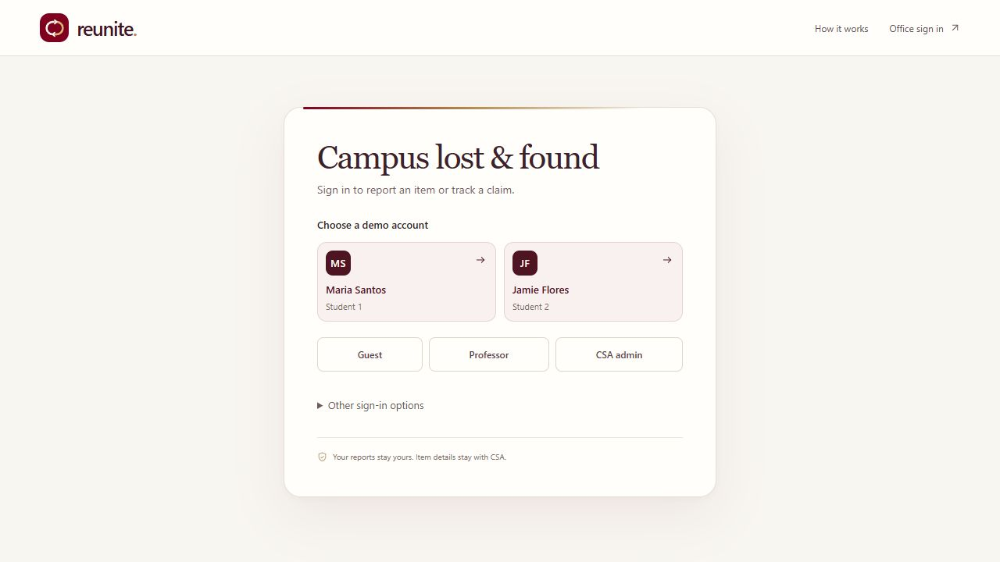

**Purpose.** Follow each action from the place you click to the code that checks it and the database record it changes. Each chapter explains where, what and how, then gives a short explanation you can say in class.

**Start.** On Windows, extract the class ZIP and open START_CSA.bat with Python 3.10 or newer installed. On Mac, extract Reunite_Mac.zip and open Reunite.app. Choose a sample account when the browser opens.

**Screenshots.** These local demo captures use fictional records. The sign-in screen, student overview, lost report form, found board, and report closure show the current design. Other screenshots illustrate earlier layouts. Controls vary by role and claim stage.

**Learning route.** Start with the user screens, then study the CSA process. Finish with the database map, source-file map and rehearsal. The HTML edition lets you click each image to enlarge it.

**Demonstration scope.** Sample users are local. Real university Microsoft sign-in and real email delivery require external settings. This installation now has local CLIP matching. A new computer needs one-time AI setup; clearly labeled typed fallback remains available without it.

> We will connect each visible action to its JavaScript handler, Python service and saved record.

---

# 1. A click becomes a server request

**Where.** Any form with a submit button, such as Report a lost item.

**What.** Opening a form changes the browser only. Submitting sends a request. The workspace refreshes after the server confirms success.

**Browser code.** static/index.html loads style.css and app.js. The click listener selects an action. The submit listener collects FormData, and api() sends JSON using fetch() with the session CSRF token.

**Server code.** web.py reads the session, checks request protections and maps the URL to a Service method. services.py checks current permissions, inputs and workflow rules.

**Database work.** Service._tx() begins a SQLite transaction. Related SQL changes commit together or roll back together on failure. Relevant actions also insert audit and notification records. Image uploads are separate requests and file writes.

**Screen response.** After a successful workflow form, load() requests /api/dashboard. render() rebuilds the workspace from saved data. toast() shows temporary feedback. An error is displayed when the operation is refused.

**What does not save.** Navigation, search, animation and canceling a form do not create business records. A failed workflow request does not commit its related updates. An earlier successful image upload can remain even if the later form fails.

```text
Click -> app.js -> api() -> web.py route
-> services.py validation -> SQLite commit
-> JSON response -> load() -> render()
```

> The browser requests the action, Python enforces the rules, and SQLite stores the result.

---

# 2. Sign in and identify the role


**Where.** Choose Maria Santos, Jamie Flores, Guest, Professor, or CSA admin under Choose a demo account. Other sign-in options contains the standard sign-in methods. Office sign in also appears in the header.

**What.** Students and professors report lost and found items. Guests report lost items. Administrators receive inventory, review suggestions and decide ownership checks, approval and release.

**How.** The sample button posts a role to /api/auth/demo. AuthService.demo_login() selects the fictional user. sign_in() rotates the session and links it to that user. load() then fetches the permitted dashboard.

**Saved.** sessions holds authentication state, while sign-in/out events are audited. The browser cookie holds an opaque token; its hash is stored on the server.

**Other login paths.** request_code()/verify_code() implement expiring guest codes. Demo mode can show the code locally. staff_login() checks a password hash and active staff account. Microsoft methods require university configuration.

**Why permissions matter.** Service._guard() reloads the current account and checks its allowed action. Changing a role label or browser button cannot grant administrator authority.

```text
POST /api/auth/demo -> demo_login()
sign_in() -> GET /api/dashboard
```

> Our demo accounts are fictional, but the server still enforces role permissions.

---

# 3. Find your way around the user workspace

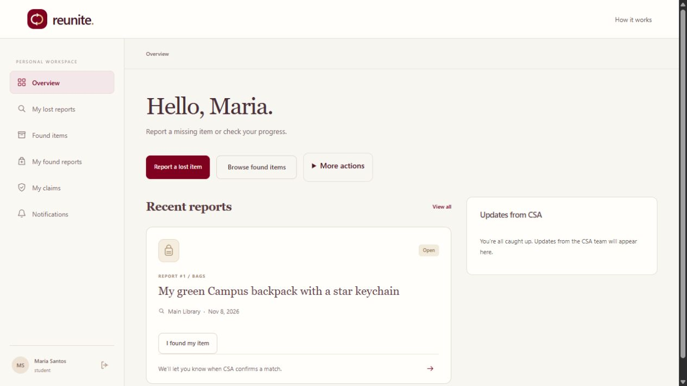

**Where.** Use the sidebar to open reports, claims, notifications, and the Found items board where your role allows it.

**What.** Overview puts Report a lost item first, with Browse found items for students and professors. More actions holds the shortcuts for tracking claims, reporting a found item, or getting help, depending on your role.

**How.** renderPersonalOverview() builds the shortcuts, recent reports and updates from state.data. Navigation changes state.view and calls render(). renderView() chooses the page to display.

**Data source.** GET /api/dashboard calls Service.dashboard(user). The server returns role-appropriate records. Ordinary users do not receive private inventory photographs or staff matching scores.

**Refresh.** refreshWorkspace() checks for updates every minute while visible and when you return to the tab. It waits if a dialog is open or you are editing an input. Successful submissions refresh immediately.

> My main actions are on Overview, and the sidebar gives me the rest of my workspace.

---

# 4. Submit a lost report

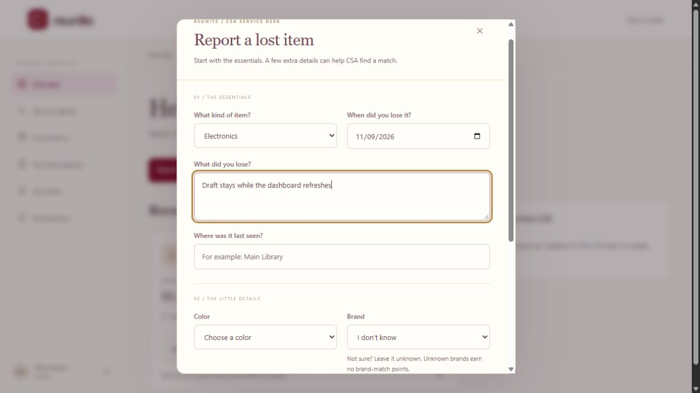

**Where.** Overview > Report a lost item, or My lost reports > Report a lost item. Student, professor and guest identities can report a loss.

**What to enter.** Category, date lost, description, color, brand and last-seen location. Add identifying marks and an optional existing photo. Use consistent typed details for the offline matching demonstration.

**Browser code.** lostForm() builds the dialog. The lost submit case optionally calls upload() with kind report_photo, then posts the form and photo ID to /api/reports/lost.

**Server and database.** create_lost_report() validates permission, fields and date. It inserts lost_reports with the owner ID and open status, adds LOST_REPORT_CREATED to audit_logs and runs matching.

**What appears.** The report appears in My lost reports after the successful save. Raw suggestions are not shown to the owner. Wait for a CSA-confirmed verification invitation.

**Important distinction.** The browser requires a complete set of descriptive fields. Python separately validates required fields and dates. Opening the form alone is not evidence of a saved report.

```text
lostForm() -> submit case lost
POST /api/reports/lost -> create_lost_report()
```

> A saved report links the loss to its owner and starts comparison with received inventory.

---

# Close a report when you find the item

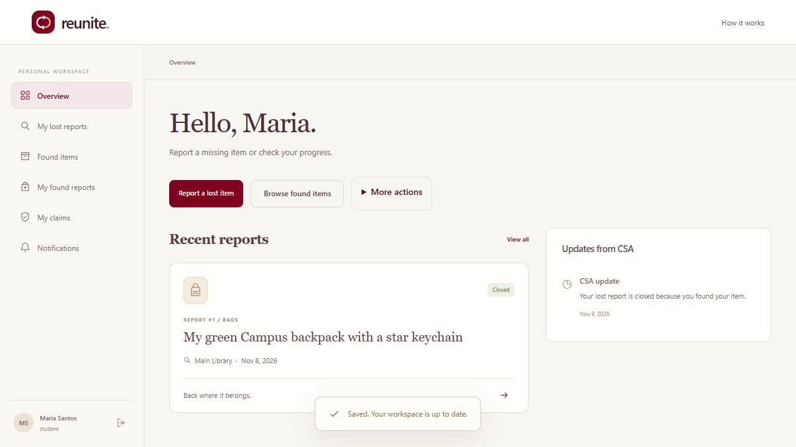

**Where.** In Overview or My lost reports, select I found my item on an open report. Confirm with Close my report.

**What.** The report becomes Closed and stays in your history. Pending suggestions and invitations for this report are dismissed. An active claim blocks self-closure so CSA can finish handling it.

**How.** The close-report action opens a confirmation form. The server checks ownership and claim status before closing the report and writing an audit entry.

**Saved.** lost_reports.status becomes closed, matches are updated, and notifications records the confirmation.

```text
POST /api/reports/close -> close_lost_report()
-> lost_reports + matches + audit_logs
```

> I can stop the search when I recover the item myself, and CSA keeps the record.

---

# Browse the found items board

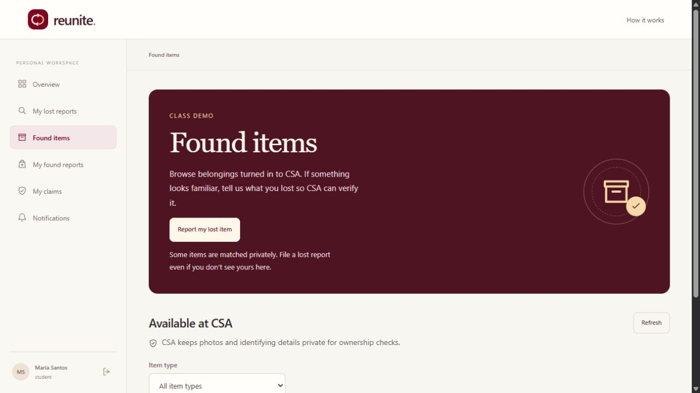

**Where.** Student or professor > Found items. Filter by item type or choose Report my lost item.

**What.** The board lists only eligible items received and shared by CSA. Cards show a broad type, area and week. CSA keeps exact dates, photos and identifying details private.

**How.** The dashboard response includes a restricted found-board list for permitted accounts. The normal lost report and CSA verification workflow still applies.

> The board helps me decide whether to file a report. CSA still verifies ownership.

---

# 5. Report a found item

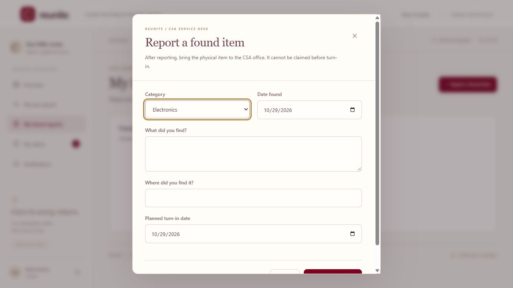

**Where.** Student or professor > My found reports > Report a found item. A guest finder brings the item directly to CSA.

**What.** Enter category, date found, description and location. The server assigns a turn-in deadline. Then physically bring the item to the CSA office.

**How.** foundForm() opens the dialog. The found submit case posts /api/reports/found. create_found_report() checks the role and dates before saving.

**Saved.** found_reports stores finder_id, description and dates with status awaiting_turn_in. Audit history records FOUND_REPORT_CREATED.

**Why it is not claimable.** An online statement that something was found does not mean CSA has custody. This is a queue entry, not received inventory. Matching uses physically received items.

**Later.** CSA receives the physical item, changes the found report to received and creates a separate items record. A notification confirms receipt to the finder.

```text
POST /api/reports/found -> create_found_report()
found_reports.status = awaiting_turn_in
```

> The found report announces a future handoff; physical receipt creates inventory.

---

# 6. CSA checks the found queue

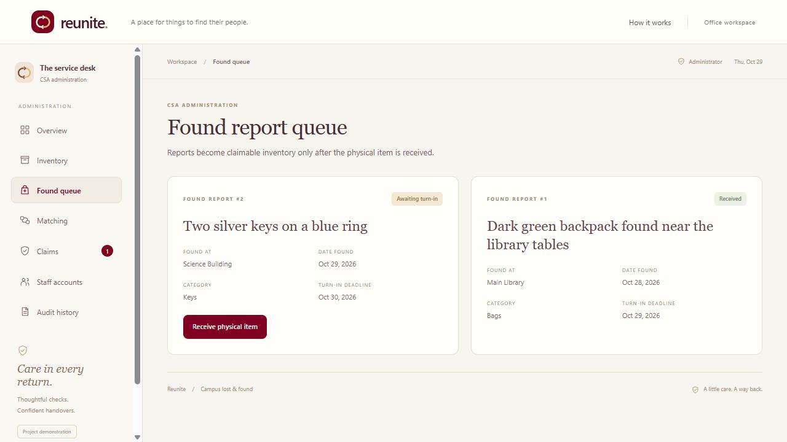

**Where.** CSA admin > Found queue. Each card shows the finder description, location, date and planned turn-in date.

**What.** Awaiting turn-in means the item is not yet in custody. Received means CSA has recorded its physical intake. Receive physical item begins intake for a pending report.

**How.** renderFound() renders cards from dashboard data. The receive-found action finds the selected report and calls receiveForm(found), which prefills its category, date, description and place.

**What is not saved yet.** Clicking Receive physical item only opens a form. No inventory record exists until staff supplies the required details and photo and saves the intake.

**Connection.** The completed intake passes found_report_id. This links the inventory to the finder report and prevents losing the original handoff context.

**Why this screen exists.** The queue separates a report from physical custody. Staff can track announced items without offering belongings that have not reached the office.

> The queue tells CSA which reported belongings are still awaiting physical turn-in.

---

# 7. Receive a physical item

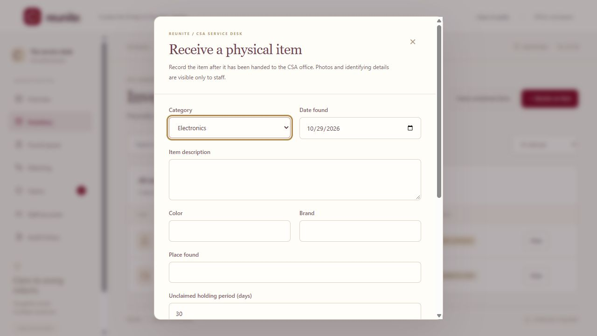

**Where.** Found queue > Receive physical item, or Inventory > Receive an item for direct turn-in. The item must already be with CSA.

**What to enter.** Category, description, color, brand, found place/date, private identifying details and a required private photograph. The holding period defaults to 30 days.

**How.** receiveForm() builds the dialog. upload() sends an item_photo to /api/uploads. The form then posts its photo ID to /api/items/receive, which calls receive_item().

**Saved.** items stores recorded_by, private_details, photo_id and available status. A linked found report becomes received. The finder is notified; intake is audited and matching runs again.

**File checks.** _photo() checks the correct upload kind, access and actual file existence. Staff-only photos and marks remain hidden from ordinary users.

**Duplicate protection.** An already received finder report is refused. The unique items.found_report_id also prevents one queue record from creating duplicate inventory.

```text
POST /api/uploads (item_photo) -> upload ID
POST /api/items/receive -> receive_item()
```

> Receipt records CSA custody and the private information needed for ownership checks.

---

# 8. Inventory, search and item status

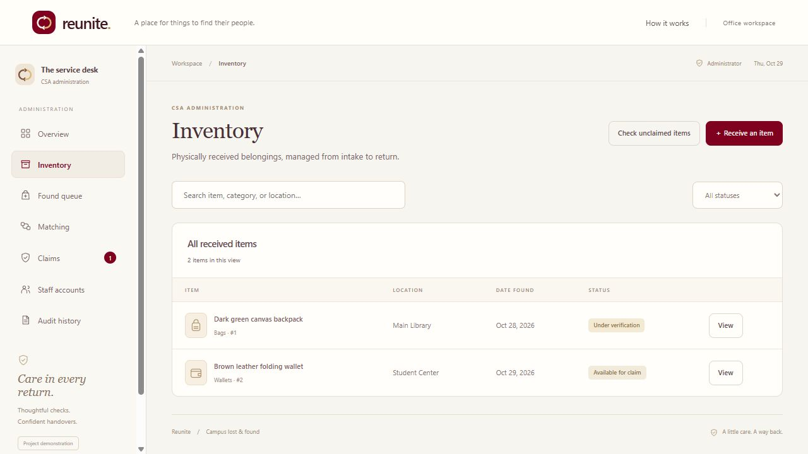

**Where.** CSA admin > Inventory. The search field and status selector are below the heading. View opens private item details.

**What.** Search checks description, category, brand, color, place and ID among loaded items. The selector narrows the displayed statuses.

**How.** The input listener updates state.query after a short delay. updateInventoryResults() filters in JavaScript. Search does not change a database row.

**Statuses.** available: received and potentially claimable. under_verification: online check passed. released: physical handover completed. unclaimed: holding period elapsed and staff applied the check.

**Reservation detail.** An online submission waits in step1_pending. Passing the online check reserves the item for in-person verification. The database allows only one in-person reservation at a time.

**Check unclaimed items.** This confirmation posts /api/items/expire to expire_items(). Old available items past their configured period become unclaimed. Active claims are excluded. It does not automatically cancel claims on a timer.

> Search changes the list on screen; receipt, checks and release change stored state.

---

# 9. Understand the matching score

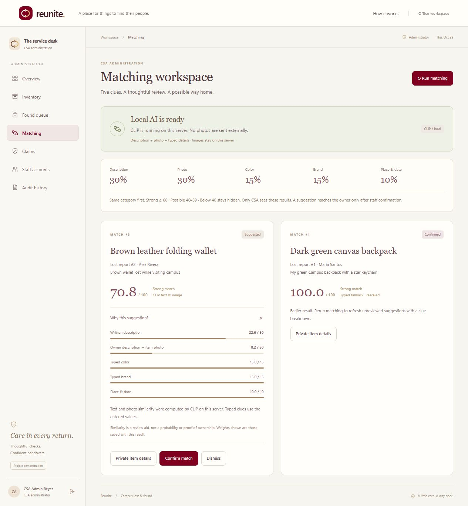

**Where.** CSA admin > Matches > Run matching. Private item details opens the hidden photograph and marks. Suggestions are visible only to CSA.

**How.** /api/matching/run calls run_matching() and _run_matching(). Open lost reports are compared with available, unreserved received items. MatchingService.compare() first requires the same category.

**Typed-detail mode.** Color and brand carry 15 points each. Place and date carry 5 each. The score is scaled by the available clues and capped at 59. Two clues among color, brand and place must agree for the suggestion to appear. The date alone cannot qualify a match.

**AI example.** The live sample wallet scored about 70.8: description 22.6, description-to-photo 8.2, color 15, brand 15 and place/date 10. Expand Why this suggestion to see the stored weights and clue contributions. These are similarity points, not ownership probability.

**Thresholds.** Strong starts at 60; possible starts at 40; below 40 is hidden. Prepared local CLIP uses description 30, photo 30, color 15, brand 15 and place/date 10. With no owner photo, it compares the owner description with the CSA image. Factory selects the usable implementation; model failure is logged and falls back.

**Saved.** matches stores report_id, item_id, score, level, method, score_details and suggested status. score_details preserves weights, contributions and whether the owner photo or description was used. Matching alone does not notify the owner or approve a claim.

```text
MatchingServiceFactory.create()
-> TypedDetailsMatchingService or AIMatchingService
-> compare(report, item)
```

> Matching suggests candidates; ownership still needs a CSA decision and both checks.

---

# 10. Confirm a suggestion and invite the owner


**Where.** Matches > Private item details, then Confirm match or Dismiss. Review the hidden information before deciding.

**What.** Confirm match opens a confirmation dialog. Confirm and invite owner records a staff decision and creates an in-app invitation. Dismiss declines the candidate without an owner invitation.

**How.** The confirm-match action uses confirmForm(). The match-decision submit case posts match_id and confirmed to /api/matches/decide. decide_match() checks that the suggestion is still undecided and the report and item remain available.

**Saved.** matches.status becomes confirmed or dismissed and decided_by stores the administrator ID. Confirmation inserts a notifications row for the owner. Both decisions are audited.

**Owner view.** The confirmed invitation appears in My claims and Notifications. Private item details and raw suggestions remain hidden. Confirmation permits verification; it is not proof of ownership.

**If reserved.** The owner workspace checks current eligibility and shows a reason when the item cannot be claimed, rather than offering an action that must fail.

```text
POST /api/matches/decide
-> decide_match(admin, match_id, confirmed)
```

> CSA reviews the automated suggestion before an owner is invited to verify.

---

# What the matching evaluation found

**Test inputs.** matching_evaluation.py compares fictional descriptions and sample illustrations. Cases cover missing clues, a paraphrased description, the wrong category, and an unrelated photo attached to otherwise matching details.

**Results.** Both modes surfaced all three intended matches. Of the five intended nonmatches, typed details surfaced one and CLIP surfaced four. See docs/MATCHING_EVALUATION.json for the scores by case.

**Review.** The unrelated photo scored 96.3 with CLIP when the written details agreed. Staff should compare the actual photo and identifying marks before confirming a suggestion.

**Next evaluation.** Use verified photos of the same campus items from different angles and in dim light, plus different items that look alike. The illustration trial measures behavior on those examples only.

> The score helps CSA prioritize what to inspect. Verification is a separate step.

---

# 11. The owner submits identifying answers

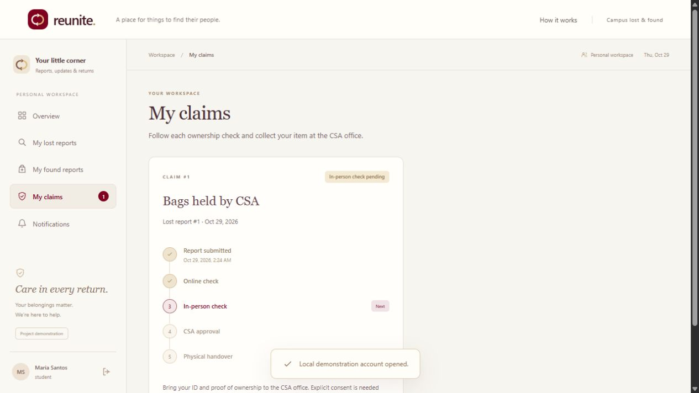

**Where.** Owner > My claims > Ready to verify > Answer ownership questions. This appears for an eligible confirmed invitation. The screenshot shows the later tracking view after an online pass.

**What.** Describe contents, marks or details only the owner should know. Agree to submit the answers and select Submit ownership answers. Do not enter account passwords.

**How.** claimForm() posts item_id, report_id, answers and consent to /api/claims/submit. submit_claim() checks account access, report ownership, confirmed invitation, open report, item availability and the rejection limit.

**Saved.** claims stores claimant_id, item_id, report_id, JSON answers, online_consent and step1_pending status. A unique index prevents the same person from opening two active claims for the same item. Passing the online check starts the exclusive in-person reservation.

**Tracking.** claimProgress() draws the five stages from saved data. It does not perform verification. userClaimMessage() explains the next real-world step.

**Retry rule.** Three rejected claims by the same claimant for the same item block further attempts. Rejected records remain history; a new report does not erase those attempts.

```text
claimForm() -> POST /api/claims/submit
-> submit_claim() -> _submit_claim()
```

> Answers create a pending claim. The owner cannot pass their own verification.

---

# 12. CSA decides the online check

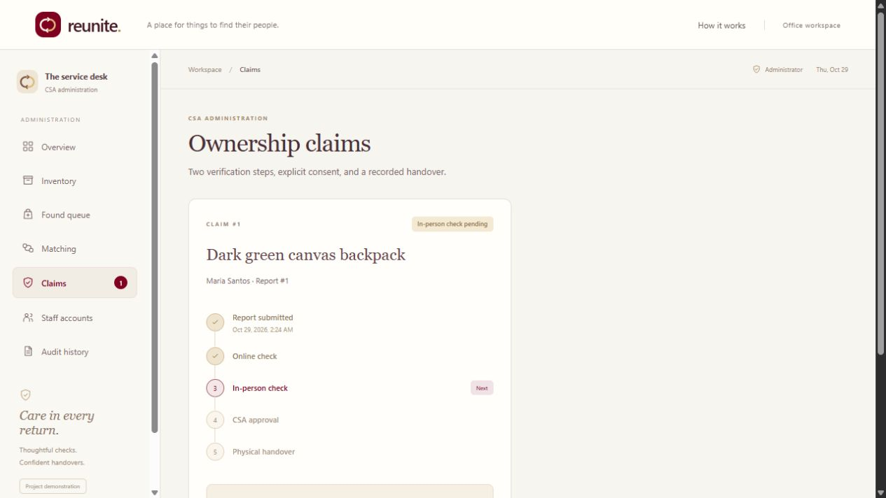

**Where.** CSA admin > Claims. Compare Ownership answers with Private item details, then choose Pass online check or Reject. The pictured claim has already passed online review.

**What.** CSA actually compares the submitted answer with hidden details. Rejecting requires a clear reason. The system records the staff decision; it does not automatically grade free-text answers.

**How.** decisionForm() posts /api/claims/online. verify_online() accepts the decision only for step1_pending. Claim.advance() and Item.change_status() enforce valid transitions.

**Saved on pass.** Claim becomes step2_pending and online_verified_by stores the administrator. Item becomes under_verification. The owner is notified to visit CSA and STEP1_PASSED is audited.

**Saved on rejection.** _reject() records rejected status and reason, removes the reservation, notifies the owner and counts attempts. If the item was under verification, it becomes available again.

**Protection.** Visible controls follow status, while service rules and SQL triggers independently reject skipped stages. Hiding the button is only one layer.

```text
POST /api/claims/online
-> verify_online() -> pass OR _reject()
```

> The first check compares online ownership answers with private inventory information.

---

# 13. Consent first, then the in-person check

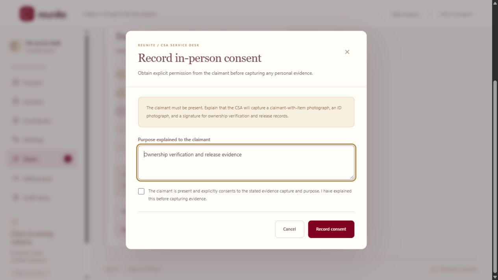

**Where.** CSA admin > Claims > Record in-person consent. After consent is recorded, Pass in-person check becomes available.

**What.** The claimant must be present. Explain the purpose of a claimant-with-item photograph, ID photograph and signature. Record explicit permission before evidence capture. Then examine ID, ownership proof and additional answers in person.

**How consent is recorded.** consentForm() posts purpose and in_person=true to /api/claims/consent. record_consent() requires an administrator and step2_pending. Online answer consent is a separate field.

**Saved.** claims stores in_person_consent, consent_at, consent_purpose and consent_recorded_by. Recording consent is audited but does not itself pass the ownership check.

**How the check passes.** decisionForm() posts /api/claims/in-person. verify_in_person() requires the online pass and consent. A pass sets verified and in_person_verified_by. A rejection records a reason and unlocks the item.

**For class.** Use fictional evidence in rehearsals. A checkbox records that CSA obtained permission; it does not replace explaining the purpose to the person.

```text
record_consent() -> consent fields
verify_in_person() -> claims.status = verified
```

> Online consent covers submitted answers; in-person consent separately covers evidence capture.

---

# 14. Save evidence and approve

**Where.** CSA admin > Claims > Evidence & approval. This control is shown for a verified claim after both checks have passed.

**What to provide.** Three required image files: claimant with the item, ID photograph and claimant signature. Optional handover notes record relevant details. Confirm the checks, identity and consent, then Save evidence and approve.

**Browser code.** approveForm() builds the dialog. The submit listener first validates all three files. upload() sends each to /api/uploads with an evidence kind and claim_id. The returned IDs are sent to /api/claims/approve.

**Python checks.** save_upload() checks administrator authority, claim stage and consent. approve_claim() requires verified status, both verifier IDs, correct evidence kinds, the same claim link, existing files and capture after consent.

**Saved.** claims receives the evidence IDs, evidence_captured_at, approved_by, approved_at, handover_note and approved status. A notification and CLAIM_APPROVED audit event are inserted.

**Still pending.** The item has not been recorded as handed over. Record physical release is the next action. Approval and handover are deliberately separate.

**If an error occurs.** Correct the missing or invalid evidence and check the saved status. Upload requests are separate, so an earlier uploaded file may exist even when approval fails. Do not call the claim approved until its status says so.

```text
POST /api/uploads x 3
POST /api/claims/approve
-> approve_claim() -> approved
```

> Approval records complete checks, consent and evidence. Actual handover still needs its own record.

---

# 15. Record the physical handover

**Where.** CSA admin > Claims > Record physical release. Hand the item to the verified owner and confirm the recorded event with Record release.

**What.** This final business action completes the claim, marks the inventory item released and closes the lost report.

**How.** The release action opens confirmForm(). The release submit case posts claim_id to /api/claims/release. release_item() requires approved status, recorded consent, both checks, approval and all three evidence files still present.

**Saved together.** claims becomes released with released_by/released_at. items becomes released. lost_reports becomes closed. The completion notification and ITEM_RELEASED audit entry are saved in the same transaction.

**What appears.** The owner timeline completes Physical handover. Their report is closed. CSA Inventory shows Claimed / released. Refresh an independently open owner session to see the new data.

**Duplicate protection.** Domain rules and SQL triggers prevent invalid transitions. A unique index prevents multiple released claims for an item. A later claim request is also refused for a released item.

**Why separate.** Approval establishes readiness. This event records actual custody changing hands and identifies the administrator and time.

```text
release_item() transaction:
UPDATE claims -> released
UPDATE items -> released
UPDATE lost_reports -> closed
INSERT notification + audit event
```

> Physical release completes the return and closes the linked report.

---

# 16. Notifications and progress

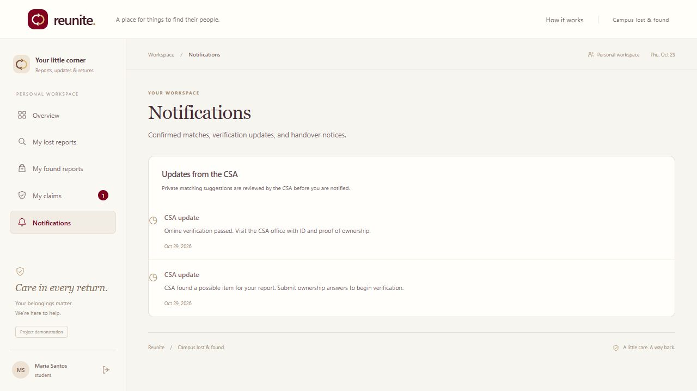

**Where.** Owner > Notifications for messages, My claims for the timeline, and My lost reports for open/closed report status.

**What.** Messages announce confirmed invitations, verification outcomes, approval and completion. Unreviewed suggestions are not owner invitations.

**How.** Service._notify() inserts a notifications row during the relevant operation. dashboard() selects records for the current user. renderNotices()/noticeList() display messages, and claimProgress() draws saved stages.

**Saved versus temporary.** A notification is a database record. The brief toast is browser feedback. Displaying an in-app notification does not mean an email was sent for that workflow event.

**Live saving.** Successful operations save immediately on the running server. The workspace then reloads its dashboard. Other computers do not automatically receive a copy of the SQLite file.

**Example.** The pictured owner has received an invitation and passed online review. The next task is visiting the CSA office, not clicking an owner-side approval button.

> Notifications explain saved events; the timeline identifies the claim stage and next task.

---

# 17. Audit history: who did what

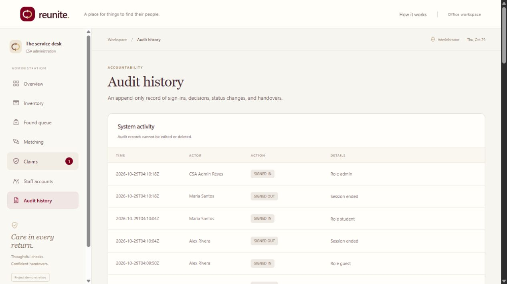

**Where.** CSA admin > Audit history. Read Time, Actor, Action and Details.

**What.** History includes sign-ins, reports, match decisions, checks, consent, approval and release. Some denied/refused requests are logged too.

**How.** AuditLog.record() in services.py inserts audit_logs. Authentication uses its own _audit() helper. dashboard() returns the history to administrators and renderAudit() displays it.

**Saved.** actor_id links a person, action names the event, detail explains it, and created_at stores the timestamp. A system action may have no person as actor.

**Protection.** schema.sql has audit_no_update and audit_no_delete triggers. Normal SQL changes to audit rows are rejected. This preserves application history; it does not mean someone controlling the database file cannot change its schema.

**Time reading.** Stored timestamps use UTC with Z. Several interface dates are converted for display, while the audit table shows the stored value. Different displayed hours can refer to the same event.

> Audit history traces the report, decisions and final handover back to the recorded actor.

---

# 18. Staff access and sign-out

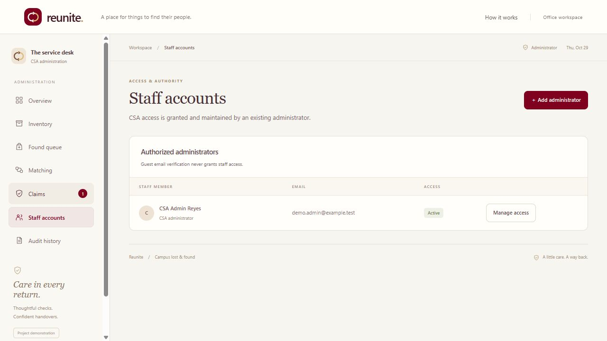

**Where.** CSA admin > Staff accounts. Add administrator starts a new staff form; Manage access edits an existing one. Sign out is beside the sidebar profile.

**What.** Only an authorized administrator can grant staff access. Guest email verification does not make someone an administrator.

**How.** staffForm() collects details. /api/staff/save calls manage_staff(), which checks permission and validates account details. Passwords are stored as hashes, not plain text.

**Saved.** users holds administrator role, password_hash and active status. Staff changes are audited. Avoid real account details in classroom screenshots.

**Sign out.** /api/logout calls AuthService.logout(), invalidates the session and clears the cookie. JavaScript clears the workspace state and returns to sign-in.

**Presentation.** You can explain the page without creating extra staff accounts during a presentation. Use the local sample administrator.

> Staff access is a separate administrator-controlled permission.

---

# 19. Appearance and animation code

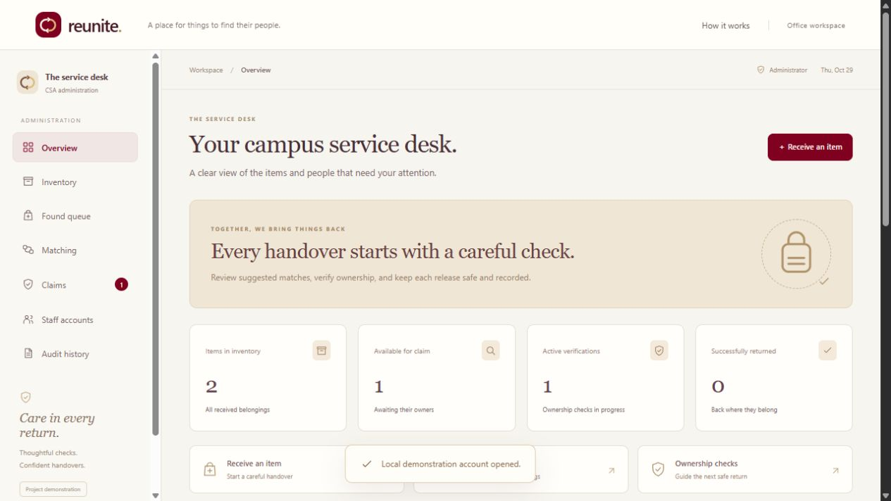

**Where.** The quiet Reunite header, personal overview, report cards and office tools share the same independent identity. Students and guests have prominent reporting and tracking paths.

**Which files.** static/index.html supplies containers and script/style references. static/style.css defines the red, ivory and gold theme, layout, responsive rules and motion. static/app.js generates workspace HTML and interaction behavior.

**Logo.** Reunite has an original loop-and-return logo, included inline in siteHeader() and saved as static/reunite-logo.svg. The interface uses burgundy, ivory and gold without the university masthead or crest.

**How motion works.** finishRender() handles entrance effects and staff counter values. showModal()/closeModal() animate dialogs. Pointer events add button ripples. Reduced-motion preferences and hidden-tab handling reduce motion when appropriate.

**Small screens.** toggleMenu()/closeMenu() manage the mobile drawer. Dialog and navigation focus handling and Escape support help keyboard use.

**Boundary.** CSS changes appearance. JavaScript controls browser interaction. Python and SQL must still enforce authorization and workflow integrity. Animation cannot approve a claim or save an item.

> The visual layer guides the user; the backend decides whether an action is allowed.

---

# 20. Database: where each thing is stored

**Files.** data/demo.sqlite3 is the normal class database. data/csa.sqlite3 is the default live database. main.py can override the database path. Photos and signatures are files under data/uploads; uploads stores metadata and references.

**Users and reports.** users stores identity, role and access state. lost_reports.owner_id links a loss to its owner. found_reports.finder_id identifies the person turning something in.

**Custody and matching.** items represents physical inventory and may link to a found report. matches connects a lost report to an item and stores the score, method and staff decision.

**Claims.** claims links claimant_id, item_id and report_id. It stores answers, verifier IDs, consent, evidence upload IDs, approval/release details and rejection reason.

**Messages and access.** notifications belongs to a user and may reference a claim/report. audit_logs records actor and event. auth.py also initializes sessions, login_codes and login_limits.

**Integrity.** Primary keys identify rows. Foreign keys connect them; Database.connect() enables enforcement. CHECK constraints restrict values. Unique indexes prevent duplicate active/released claims. Triggers guard status transitions and append-only audit.

**Backup and sharing.** Stop the server and copy the database and uploads together. Source ZIPs start a fresh local dataset unless saved data is intentionally included. Each groupmate running a separate copy has a separate database, not shared cloud storage.

```text
users -> lost_reports -> matches <- items
users -> found_reports -> items
users + lost_reports + items -> claims
claims -> evidence IDs -> uploads -> files
```

> Linked IDs keep reports, belongings, claimants and evidence connected without putting everything in one table.

---

# 21. Which code file should we open?

**Startup and HTTP.** main.py chooses the mode/database, initializes the schema, seeds demo records and starts the server. web.py maps routes and handles JSON, sessions, uploads and protected file delivery. This project uses Python's built-in HTTP server, not Flask.

**Workflow.** services.py contains the business operations: reporting, intake, matching, eligibility, verification, consent, approval, release, expiry, staff changes and dashboard data.

**Roles and state.** users.py defines User, Student, Professor, Guest and CSAAdministrator. permissions() is overridden to provide role-appropriate behavior. domain.py protects Item and Claim status behind controlled methods.

**Matching patterns.** matching.py defines abstract MatchingService.score(), typed and AI implementations, MatchingServiceFactory and ClipAdapter. compare() uses the shared interface. ClipAdapter translates embed_text/embed_image into the external model's encode() calls.

**Storage.** database.py owns SQLite connections. schema.sql defines tables, constraints, indexes and triggers. storage.py restricts upload paths. seed.py creates fictional records. demo.py performs a repeatable workflow.

**Front-end bridge.** In static/app.js, find lostForm(), receiveForm(), claimForm(), claimActions(), api(), load() and the document submit listener. The submit switch connects each form name to its API route.

**Tests.** tests/ covers workflow, authentication, integrations and storage. Open docs/TEST_RESULTS.txt for the latest results. matching_evaluation.py tests both scoring modes using fictional descriptions and illustrations.

> We explain OOP using actual classes and methods and show their saved effects.

---

# 22. Where to look when something fails

**Website does not open.** Keep START_CSA.bat running and check http://127.0.0.1:8765. Read the server window for startup or occupied-port errors. A closed server is different from an incorrect sign-in.

**Microsoft is disabled.** Expected in the agreed local class demo. Use the sample accounts. Real university sign-in needs an approved application and settings.

**No match.** Check physical receipt rather than only a found report, the same category, open report and no active reservation. Typed mode needs matching normalized details with agreement on two of color, brand and place. Below 40 stays hidden. CSA can rerun matching.

**No answer button.** The suggestion may not be confirmed, the item may be reserved, the report may be closed or three rejections may block that claimant. Read the eligibility note.

**No next verification button.** Online pending shows online decisions. Step 2 first needs consent, then the in-person decision. Verified shows Evidence & approval. Approved shows physical release. Controls follow state.

**Evidence error.** Choose PNG, JPEG or WebP within the browser's 5 MB limit. Evidence must link to this claim, follow consent and still exist in uploads. Copying only SQLite can break image references.

**Records seem missing.** Check database path and demo/live mode. A new extraction can have a new dataset. A saved change persists on that server; it is not automatically copied into another project folder.

> Check the current record, role and stage before assuming a button is broken.

---

# 23. Rehearse while clicking

**Prepare.** Agree on each member's actual responsibilities. Use fictional data and evidence. Keep this guide next to the browser and source files. Do not claim someone wrote a component they did not write.

**Explain the user journey.** Show Student, Overview, a lost report form and My claims. Say what the owner enters, what stays private and why a verification invitation must be confirmed by CSA.

**Explain the CSA journey.** Show Found queue, intake, Inventory, Matching and Claims. Explain physical custody, comparison, staff confirmation, two checks, consent, evidence, approval and separate handover.

**Trace one action.** Choose Submit lost report. Open lostForm(), submit case lost, /api/reports/lost in web.py, create_lost_report() in services.py and lost_reports in schema.sql. Identify input, permission, INSERT and visible refresh.

**Cleone's database explanation.** Use one report ID, item ID and claim ID to explain foreign keys. Show one_in_person_claim and the audit/status triggers. Explain why images and SQLite must be backed up together.

**Explain a refusal.** Describe release before approval or a second in-person reservation. Connect the visible stage to the service check and SQL rule. demo.py provides repeatable scripted examples.

**Check understanding.** For any button, can everyone identify the role, input, route, service, table, next state and remaining real-world task? That is understanding the interaction rather than memorizing a screen.

```text
WHERE -> ACTION -> INPUT -> CODE CHECK
-> SAVED RECORD -> SCREEN RESULT -> WHY
```

> One visible action should connect clearly to one server operation and its saved result.

---

# 24. Exact source lookup

**static/app.js:54.** async function api(

**static/app.js:419.** function lostForm(

**static/app.js:371.** function claimActions(

**static/app.js:508.** document.addEventListener('submit'

**web.py:38.** def handle(

**services.py:58.** def _tx(

**services.py:189.** def create_lost_report(

**services.py:269.** def receive_item(

**services.py:439.** def _submit_claim(

**services.py:506.** def verify_online(

**services.py:533.** def record_consent(

**services.py:566.** def verify_in_person(

**services.py:585.** def approve_claim(

**services.py:607.** def release_item(

**services.py:733.** def dashboard(

**schema.sql:66.** CREATE TABLE IF NOT EXISTS claims

**schema.sql:87.** CREATE UNIQUE INDEX IF NOT EXISTS one_in_person_claim

**schema.sql:111.** CREATE TRIGGER IF NOT EXISTS audit_no_update

> Use Find in your editor to jump to the function name. Line numbers refer to this project version.

---
