# CSA Lost and Found workflow

The application follows a lost item from its physical receipt at the CSA office to release to a verified owner. Online found reports form a handoff queue; they are not inventory and cannot be claimed until CSA receives the physical item.

```mermaid
flowchart TD
    Start([Start]) --> SignIn{Sign in method}
    SignIn -->|Student or professor| Microsoft[Check the allowed-emails list, then validate the emailed 6-digit code]
    SignIn -->|Guest| OTP[Validate emailed one time code and expiry]
    SignIn -->|CSA| Staff[Validate staff password and active administrator role]
    Microsoft --> UserDash[Open permitted user dashboard]
    OTP --> UserDash
    Staff --> AdminDash[Open CSA dashboard]
    UserDash --> Action{Report type}
    Action -->|LPU found report| Found[Save report awaiting physical turn in]
    Found --> Receive[CSA receives physical item]
    AdminDash --> Receive
    Receive --> Inventory[Record photo and private details in inventory]
    Action -->|Lost report| Lost[Save owner lost report]
    Inventory --> Match[Compare same category using available matching service]
    Lost --> Match
    Match --> Suggested{Score at least 40 percent}
    Suggested -->|No| Wait[Keep report open without AI result notification]
    Wait -->|New received item or rerun| Match
    Suggested -->|Yes| Review[CSA reviews private details and suggested score]
    Review --> Confirmed{CSA confirms match}
    Confirmed -->|No| Dismiss[Dismiss suggestion without owner notice]
    Dismiss --> Wait
    Confirmed -->|Yes| Invite[Notify owner to verify ownership]
    Invite --> Answers[Owner submits private identifying answers]
    Answers --> Eligible{Eligible user and item with no active claim}
    Eligible -->|No| Refuse[Reject operation with reason and preserve state]
    Refuse --> End([End or eligible retry])
    Eligible -->|Yes| Reserve[Save one active claim and reserve item]
    Reserve --> Online[CSA compares answers with hidden details]
    Online --> Step1{Online verification passes}
    Step1 -->|No| Reject[Reject with reason and count attempt]
    Reject --> Unlock[Unlock item for eligible claimants]
    Unlock --> Limit{Fewer than three rejected attempts}
    Limit -->|Yes| Answers
    Limit -->|No| Block[Block this claimant from further claims on this item]
    Block --> End
    Step1 -->|Yes| InPerson[Mark under verification and invite in person visit]
    InPerson --> Consent{Explicit capture consent given in person}
    Consent -->|No| Pause[Pause without evidence capture approval or release]
    Pause --> Consent
    Consent -->|Yes| SaveConsent[Record time and purpose before capture]
    SaveConsent --> Check[CSA checks identity and proof of ownership in person]
    Check --> Step2{In person verification passes}
    Step2 -->|No| Reject
    Step2 -->|Yes| Evidence[Upload claimant with item photo ID photo and signature]
    Evidence --> Gate{Both passes consent and required evidence recorded}
    Gate -->|No| Refuse
    Gate -->|Yes| Approve[Approve claim]
    Approve --> Release[Release item and save handover time and administrator]
    Release --> Complete[Close report notify owner and prevent further claims]
    Complete --> Invalid[Another person attempts claim on released item]
    Invalid --> InvalidResult[Reject already released operation and keep final state]
    InvalidResult --> Audit[Preserve claim history and append only audit records]
    Audit --> Logout[Sign out]
    Logout --> Finish([End])
```

The diagram shows the ownership checks and rejected operation explicitly. Authentication routes, permission checks, and database transactions also reject malformed or unauthorized requests before a workflow transition can happen.

## State changes

| Record | Valid progress |
|---|---|
| Found report | Awaiting turn in to received |
| Item | Available to under verification to released |
| Item after failed verification | Under verification back to available |
| Unreserved expired item | Available to unclaimed |
| Claim | Step 1 pending to Step 2 pending to verified to approved to released |
| Failed claim | A pending verification stage to rejected |
| Lost report | Open to closed when its item is released |

Released and unclaimed items do not return to claimable status. Three rejected attempts apply to the same claimant and item; they do not block other eligible people from claiming that item.

## Demonstration sequence

1. Sign in as an administrator and receive a physical item. Enter private identifying details that an owner can describe, and attach its private photo.
2. Sign in as an LPU user or guest and submit a lost report with matching category, color, brand, place, and a plausible lost date.
3. As an administrator, review the automatically created suggestions, rerun matching if needed, and confirm an appropriate suggestion. The user receives an ownership verification invitation only after this confirmation.
4. As the invited user, submit identifying answers and the required submission agreement.
5. As an administrator, compare those answers, pass online verification, and record explicit consent during the in person visit.
6. Pass the in person identity and ownership check. Upload the three required evidence images, approve the claim, and release the item.
7. Verify that the item is released, the claim is complete, the report is closed, and a later claim is refused.
8. Inspect the administrator audit history and run the automated checks described in the README.

Use invented identities and test images during classroom demonstrations. Live Microsoft sign in, SMTP delivery, and optional local DINOv2/CLIP matching require their corresponding deployment configuration.

`python scripts/demo.py` runs the complete sequence in a temporary database and demonstrates five refused invalid operations. The automated suite (`python -m unittest discover -s tests`) also covers simultaneous claim submissions, sign-up validation, uploads and HTTP authentication.
